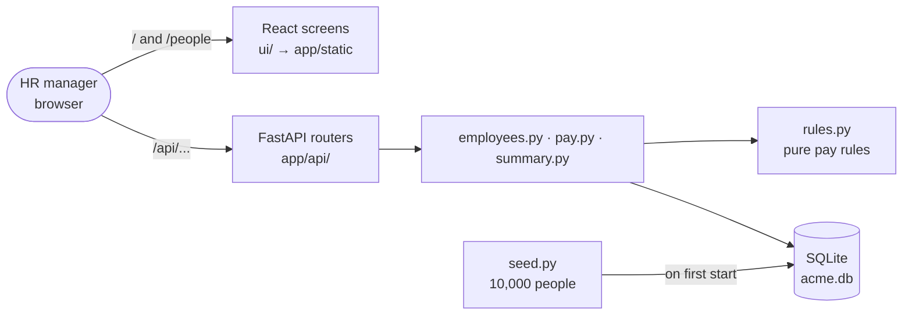
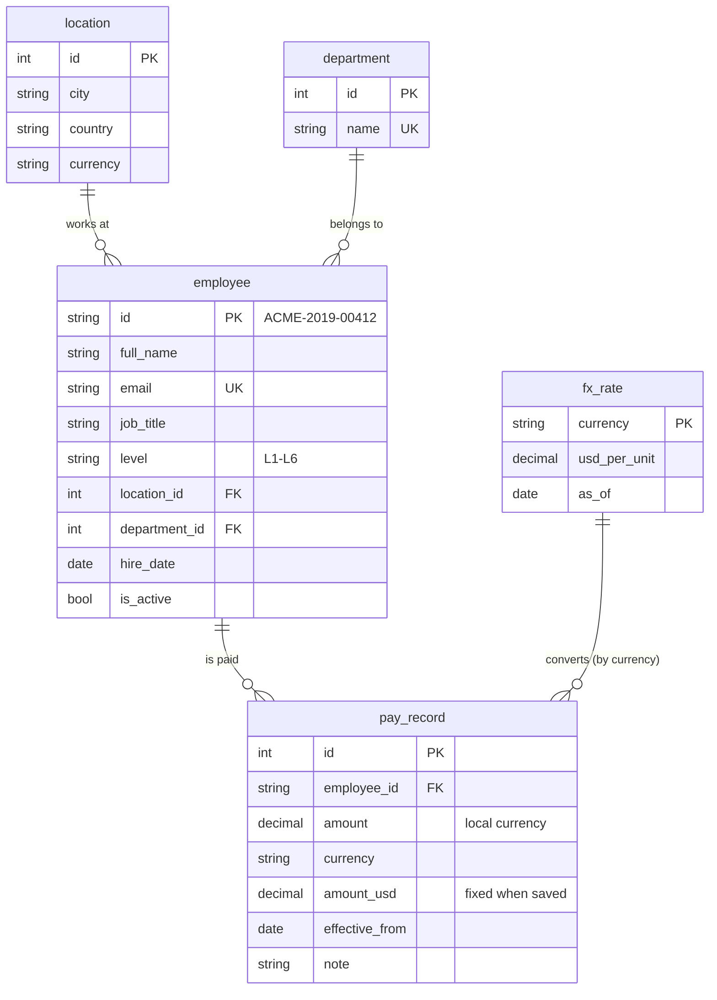

# Architecture

One service. The browser loads the React screens from FastAPI and calls `/api` on the same address. FastAPI reads and writes one SQLite file. Business rules sit in a module that knows nothing about the web or the database.

## Data model

Pay is a dated record, never a column on the employee. Current pay is the newest record for each person.

Rules the database enforces itself: a pay record must belong to an existing employee (foreign key), and one employee cannot have two pay records on the same day (unique `employee_id, effective_from`).

## Where things live

| Path | Job |
| --- | --- |
| `app/rules.py` | Pay rules as pure functions: positive amount, location currency, not before hire, USD rounding |
| `app/pay.py` | Current pay (window function) and recording a pay change |
| `app/employees.py` | People list and detail; shared filters |
| `app/summary.py` | Pay answers: headcount, payroll, lowest, median, highest per group, in SQL |
| `app/seed.py` | The same 10,000 people every run |
| `app/api/` | HTTP layer only: request/response shapes; errors mapped to status codes once in `main.py` |
| `ui/src/pages/` | Pay answers and People screens |
| `tests/` | One file per module, named as the rules they check |
